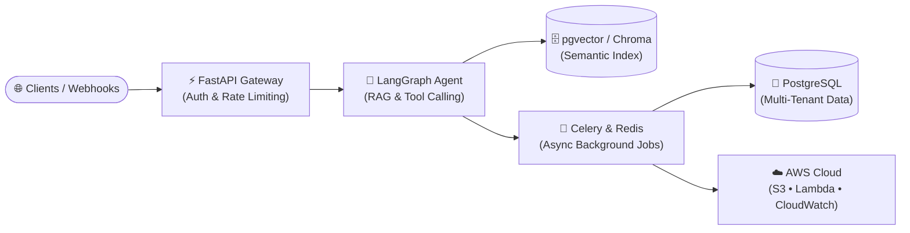

# Hi there, I'm Nitesh Sahu 👋

Building resilient microservices, high-throughput APIs, and enterprise RAG & Agentic AI systems.

---

## 📌 About Me

<table width="100%">
  <tr>
    <td align="center" width="33%">
        
      <b>Backend Engineering</b> 
      High-throughput APIs, async microservices & cloud architectures in FastAPI & AWS
    </td>
    <td align="center" width="33%">
        
      <b>AI & Agentic Systems</b> 
      Autonomous multi-agent workflows, vector search & semantic retrieval pipelines
    </td>
    <td align="center" width="33%">
        
      <b>Production Impact</b> 
      Filed 1,967+ tax returns (ITR-6) & architected 21-module multi-tenant SaaS
    </td>
  </tr>
</table>

<table width="100%">
  <tr>
    <td width="50%">
      🚀 <b>Currently Building:</b> Autonomous agent systems with LangGraph & Model Context Protocol (MCP).
    </td>
    <td width="50%">
      🔬 <b>Currently Exploring:</b> Vector quantization, distributed consensus (Raft), and async microservice resilience.
    </td>
  </tr>
</table>

---

## 🛠️ Tech Stack & Capabilities

<table>
  <tr>
    <td width="25%" valign="top">
      <h4>🧠 AI & GenAI</h4>
       
       
       
       
       
       
      
    </td>
    <td width="25%" valign="top">
      <h4>⚡ Backend & APIs</h4>
       
       
       
       
       
       
      
    </td>
    <td width="25%" valign="top">
      <h4>🗄️ Databases & Async</h4>
       
       
       
       
       
       
      
    </td>
    <td width="25%" valign="top">
      <h4>☁️ Cloud & DevOps</h4>
       
       
       
       
       
       
      
    </td>
  </tr>
</table>

---

## 📐 System Architecture Philosophy

Here is my core design pattern for high-throughput, agentic backend platforms:

---

## 🚀 Featured Projects

<table width="100%">
  <tr>
    <td width="50%" valign="top">
      <h3>🤖 AI Agentic RAG System</h3>
      
Autonomous AI agents combining real-time API execution with hybrid vector document retrieval.

      
      
      
      
    </td>
    <td width="50%" valign="top">
      <h3>🏫 Multi-Tenant SaaS Platform</h3>
      
21-module school management system with strict tenant isolation, JWT authentication, and RBAC.

      
      
      
      
    </td>
  </tr>
  <tr>
    <td width="50%" valign="top">
      <h3>⚡ Compliance Automation Engine</h3>
      
Mission-critical engine processing & filing 1,967+ corporate tax returns (ITR-6) against compliance schemas.

      
      
      
      
    </td>
    <td width="50%" valign="top">
      <h3>🔌 OAuth & Microservices API</h3>
      
Production-grade asynchronous microservices with third-party OAuth2 integration and RESTful contracts.

      
      
      
      
    </td>
  </tr>
</table>

---

## 🏆 Engineering Milestones & Achievements

<table width="100%">
  <tr align="center">
    <td width="25%">
        
      <b>Active Contributor</b> 
      High shipping velocity & consistency
    </td>
    <td width="25%">
        
      <b>High Throughput</b> 
      Automated corporate tax returns (ITR-6)
    </td>
    <td width="25%">
        
      <b>Backend & GenAI</b> 
      Enterprise delivery @ Mobifly & PwC
    </td>
    <td width="25%">
        
      <b>Open Source</b> 
      FastAPI, AI agents & cloud systems
    </td>
  </tr>
</table>

  

---

## 📊 GitHub Analytics & Activity

  
  

 

  

  <picture>
    <source media="(prefers-color-scheme: dark)" srcset="https://raw.githubusercontent.com/niteshsahujhansi/niteshsahujhansi/output/github-contribution-grid-snake-dark.svg">
    <source media="(prefers-color-scheme: light)" srcset="https://raw.githubusercontent.com/niteshsahujhansi/niteshsahujhansi/output/github-contribution-grid-snake.svg">
    
  </picture>

---

### 🤝 Let's Connect & Collaborate
Looking for a **Backend Engineer** or **GenAI Developer** to build resilient systems? Let's talk!

 

